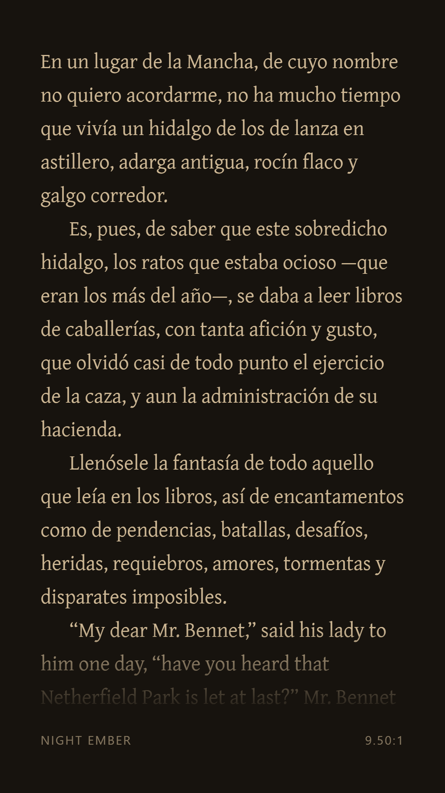
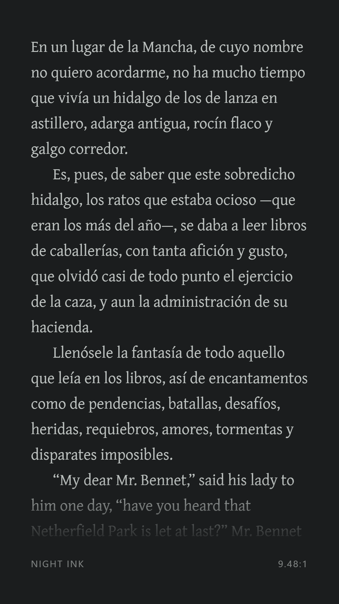
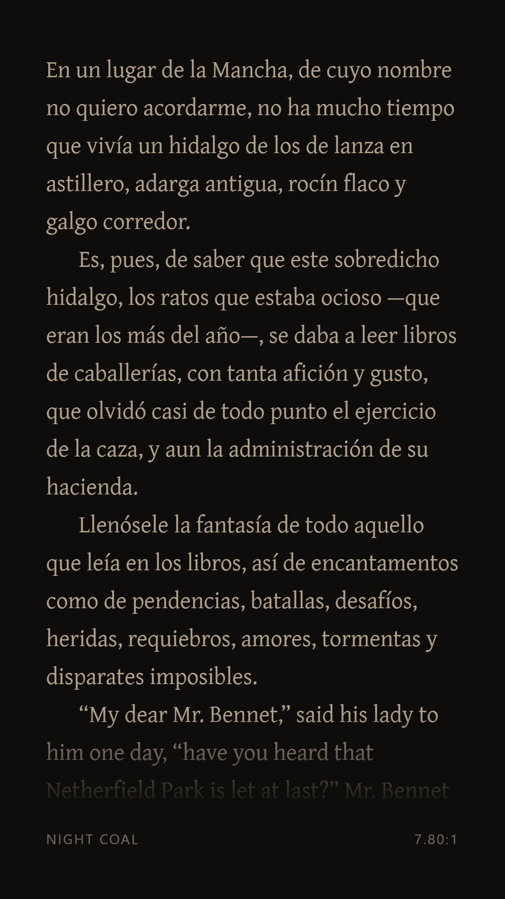
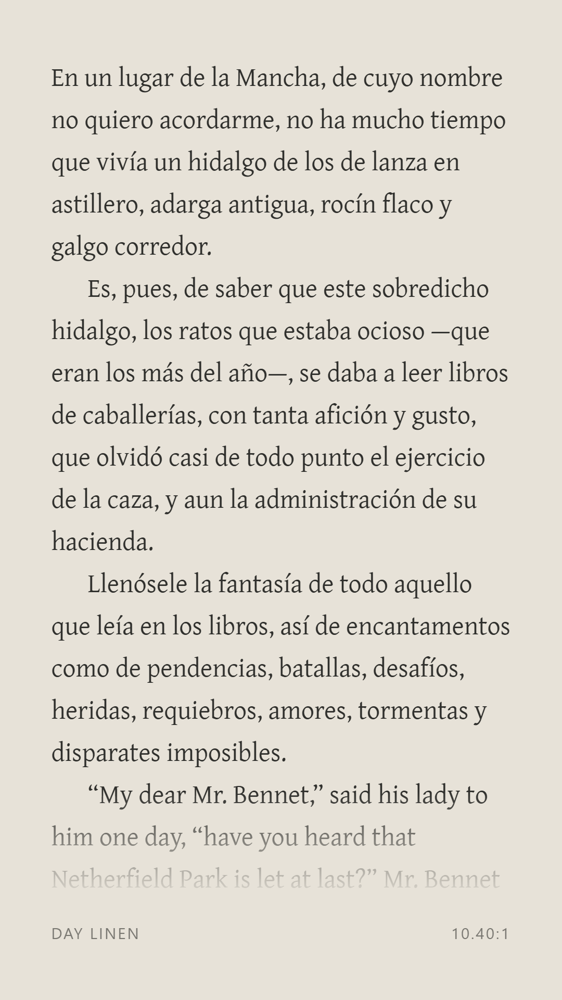
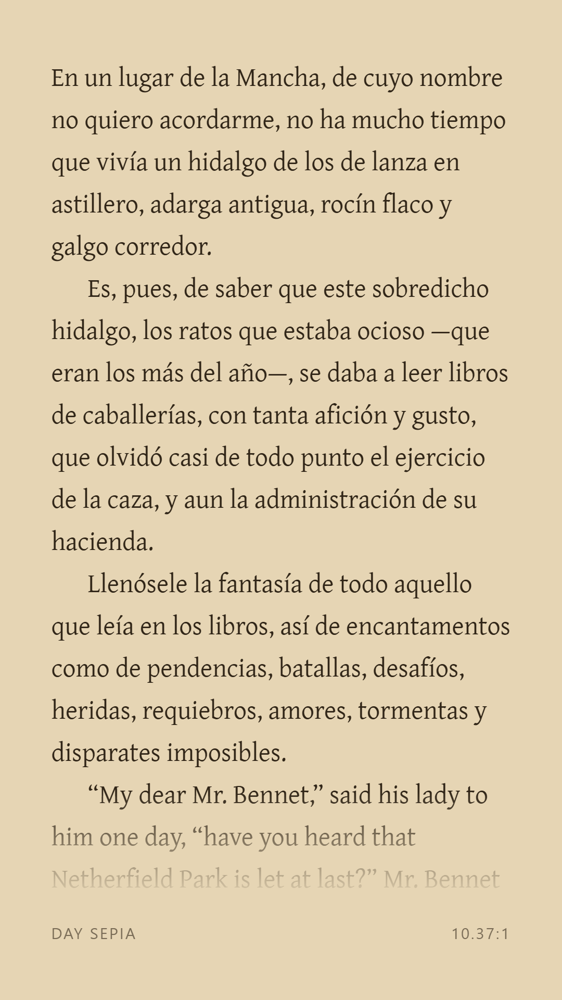

# Temas de lectura tranquila para Moon+ Reader

Seis temas para Moon+ Reader armados alrededor de una idea: **una pantalla de lectura
tiene que ser calma**.

Acá ningún par de colores está elegido a ojo: cada uno resuelve a un objetivo de
contraste medido, y cada tema de noche tiene su par de día, así el interruptor
día/noche de la app nunca te deja de golpe con un fondo encandilante.

*[English version](README.md)*

## Vistas previas

<table>
<tr>
<td align="center"><br><sub><b>Night Ember</b></sub></td>
<td align="center"><br><sub><b>Night Ink</b></sub></td>
<td align="center"><br><sub><b>Night Coal</b></sub></td>
</tr>
<tr>
<td align="center"><br><sub><b>Day Parchment</b></sub></td>
<td align="center"><br><sub><b>Day Linen</b></sub></td>
<td align="center"><br><sub><b>Day Sepia</b></sub></td>
</tr>
</table>

Están renderizadas con los valores que guarda cada tema y su misma tipografía, no son
capturas del teléfono: el fondo y la tinta son exactamente los colores que tiene
adentro el archivo `.mrthemes`.

## Instalación

1. Bajate los `.mrthemes` que quieras de [`themes/`](themes).
2. En Moon+ Reader: **☰ → Themes → Import**, elegís el archivo y tocás **OK**.
3. Vas a **Visual Options → Themes** y lo seleccionás.
4. Mantené apretado un tema en esa lista para asignarlo como **Day theme** o
   **Night theme**, así el interruptor día/noche alterna entre el par que elegiste.

Probado con Moon+ Reader Pro en Android.

## El set

| Tema | Modo | Fondo | Texto | Contraste |
| --- | --- | --- | --- | --- |
| [Night Ember](themes/Night%20Ember.mrthemes) | noche | `#17130E` casi negro cálido | `#CDB794` tinta ámbar | 9.50:1 |
| [Night Ink](themes/Night%20Ink.mrthemes) | noche | `#1B1D1E` gris neutro bajo | `#BEC3C1` | 9.48:1 |
| [Night Coal](themes/Night%20Coal.mrthemes) | noche, luz muy baja | `#0E0D0B` | `#B2A28B` | 7.80:1 |
| [Day Parchment](themes/Day%20Parchment.mrthemes) | día | `#EFE4CD` papel cálido | `#3B2E1F` marrón | 10.43:1 |
| [Day Linen](themes/Day%20Linen.mrthemes) | día | `#E7E2D8` gris cálido | `#2F2F2C` | 10.40:1 |
| [Day Sepia](themes/Day%20Sepia.mrthemes) | día, ambiente luminoso | `#E6D5B4` tintado fuerte | `#302517` | 10.37:1 |

## Por qué estos números

Blanco puro sobre negro puro da 21:1, y esa es la configuración *menos* cómoda para
leer mucho rato: dilata la pupila al máximo, así que con astigmatismo cada letra se
vuelve un halo, y la luminancia del fondo salta cada vez que levantás la vista. La
banda útil para texto corrido es más o menos **7:1 a 12:1**, con el fondo bajo de noche
y el texto lejos del blanco puro.

Otras decisiones deliberadas:

- **Nunca texto `#FFFFFF`, nunca fondo `#000000`.** El off-white cálido y el casi-negro
  cálido bajan la emisión de azul y evitan el smear que los OLED muestran en 0.
- **Sangría francesa en vez de justificado** (`pTextJustified=false`). Sin hyphenation
  consistente, el justificado abre ríos de espacio en blanco que cortan el ritmo de
  lectura. Es un toggle en Visual Options si preferís justificado.
- **Interlineado y márgenes generosos** (`pLineSpace=5`, márgenes laterales de 82).
  Después del color, es la mejora de confort más barata que hay.
- **Gentium Plus embebida** en cada archivo (SIL OFL), así el texto se ve igual en
  cualquier dispositivo. Negrita e itálica son sintéticas, porque Moon+ guarda una sola
  fuente por tema.

## Cómo funciona el formato

Un `.mrthemes` es un ZIP común:

```
Night Ember.mrthemes
├── theme_Night Ember.xml     <- <map> de SharedPreferences de Android con las opciones
└── GentiumPlus-Regular.ttf   <- fuente opcional, la app la extrae
```

Dos detalles que confunden a todo el mundo:

1. **Los colores son enteros ARGB de 32 bits con signo.** `#EFE4CD` se escribe
   `-1055539`, porque `0xFFEFE4CD` leído como `int` es negativo. No podés pegar hex.
2. **El XML debe llamarse `theme_<Nombre>.xml`**, y `<Nombre>` es lo que la app lista.

O sea que la app no hace falta para armar un tema: con `zip` y un editor de texto
alcanza. La app solo exporta desde **Visual Options → Save as theme**.

## Personalizar

`build_themes.py` genera todo el set. Editás la lista `THEMES` y lo corrés de nuevo:

```bash
python3 build_themes.py
```

Cada entrada lleva `bg` (fondo), `anchor` (el tinte hacia el que va el texto), `target`
(contraste deseado: la luminancia del texto se resuelve para dar exacto ese número y
mantener el tono del anchor), más `size` y `spacing`. El script reabre cada archivo que
escribe y controla integridad del zip, forma del XML y que los enteros de color
vuelvan idénticos.

Para pasar un color hex al entero que quiere el XML:

```bash
python3 -c "import sys; h=sys.argv[1].lstrip('#'); u=(0xFF<<24)|int(h,16); print(u-(1<<32) if u>=1<<31 else u)" '#EFE4CD'
# -1055539
```

Las imágenes de preview se regeneran con `build_previews.py` (necesita un Chromium
headless y un servidor HTTP local, porque el navegador tiene que cargar la fuente
desde un origen HTTP).

## Créditos

El formato de archivo y la idea del par día/noche vienen de
[corbrandt/Moon-Reader-Themes](https://github.com/corbrandt/Moon-Reader-Themes), que
publicó tres temas elegidos a mano. Este repo mantiene esa idea y reemplaza la
elección de colores por colores calibrados.

## Licencia

Temas y scripts: MIT — ver [LICENSE](LICENSE).
Gentium Plus: SIL Open Font License 1.1 — ver [fonts/OFL.txt](fonts/OFL.txt).