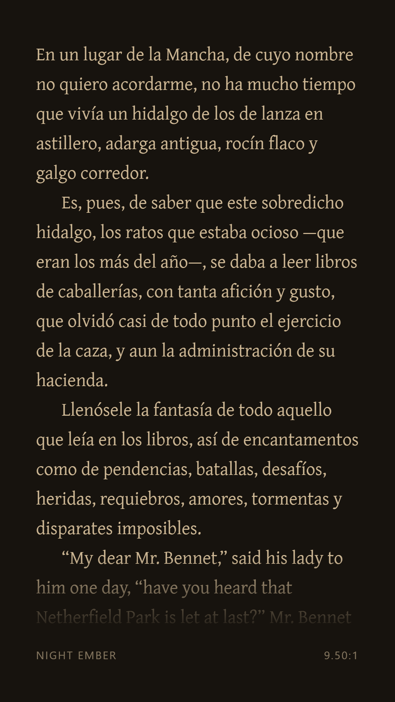
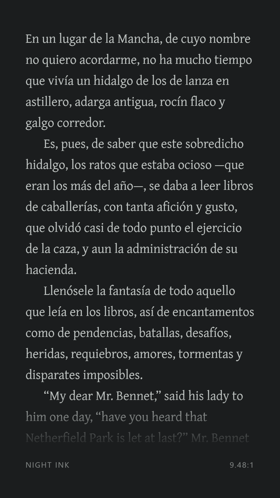
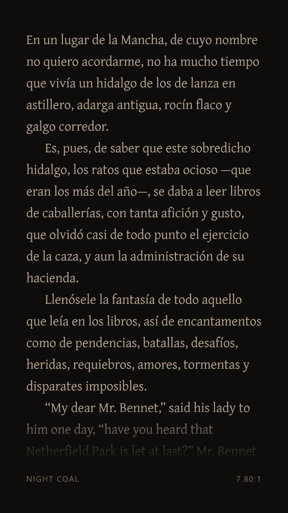
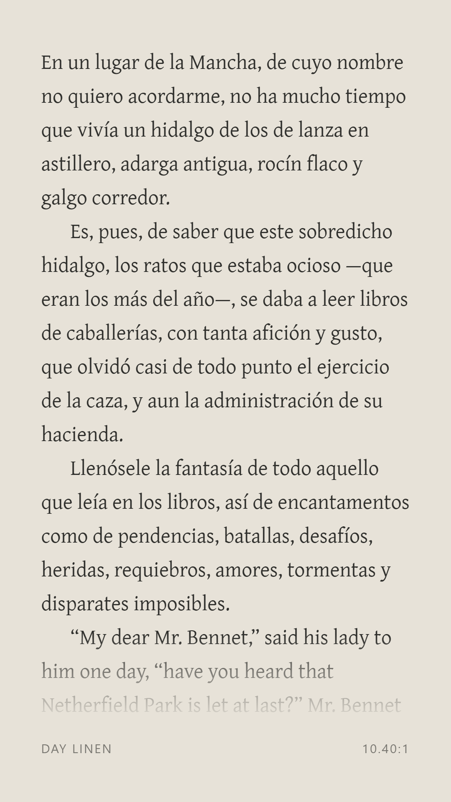
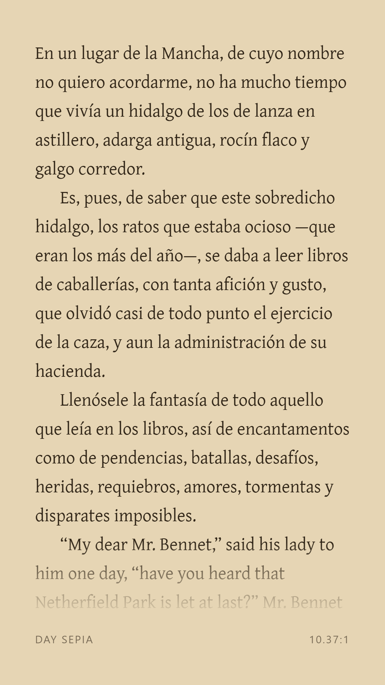

# Quiet reading themes for Moon+ Reader

Six themes for Moon+ Reader built around one idea: **a reading screen should be calm**.

Every colour pair here is solved to a measured contrast target instead of picked by
eye, and each night theme has a matching day theme so the built-in day/night switcher
never drops you into a glare.

*[Versión en español](README.es.md)*

## Previews

<table>
<tr>
<td align="center"><br><sub><b>Night Ember</b></sub></td>
<td align="center"><br><sub><b>Night Ink</b></sub></td>
<td align="center"><br><sub><b>Night Coal</b></sub></td>
</tr>
<tr>
<td align="center"><br><sub><b>Day Parchment</b></sub></td>
<td align="center"><br><sub><b>Day Linen</b></sub></td>
<td align="center"><br><sub><b>Day Sepia</b></sub></td>
</tr>
</table>

These are rendered from each theme's stored values with the bundled font, not phone
screenshots — the background and ink are the exact colours the `.mrthemes` file holds.

## Install

1. Download the `.mrthemes` files you want from [`themes/`](themes).
2. In Moon+ Reader: **☰ → Themes → Import**, pick the file, tap **OK**.
3. Go to **Visual Options → Themes** and select it.
4. Long-press a theme in that list to assign it as **Day theme** or **Night theme**, so
   the day/night switcher toggles between the pair you chose.

Tested with Moon+ Reader Pro on Android.

## The set

| Theme | Mode | Background | Text | Contrast |
| --- | --- | --- | --- | --- |
| [Night Ember](themes/Night%20Ember.mrthemes) | night | `#17130E` warm near-black | `#CDB794` amber ink | 9.50:1 |
| [Night Ink](themes/Night%20Ink.mrthemes) | night | `#1B1D1E` neutral dim | `#BEC3C1` | 9.48:1 |
| [Night Coal](themes/Night%20Coal.mrthemes) | night, very low light | `#0E0D0B` | `#B2A28B` | 7.80:1 |
| [Day Parchment](themes/Day%20Parchment.mrthemes) | day | `#EFE4CD` warm paper | `#3B2E1F` warm brown | 10.43:1 |
| [Day Linen](themes/Day%20Linen.mrthemes) | day | `#E7E2D8` neutral warm grey | `#2F2F2C` | 10.40:1 |
| [Day Sepia](themes/Day%20Sepia.mrthemes) | day, bright rooms | `#E6D5B4` heavy tint | `#302517` | 10.37:1 |

## Why these numbers

Pure white on pure black is 21:1, and that is the *least* comfortable setting for long
reading: it maximises pupil dilation, so astigmatism turns every letter into a halo, and
the background luminance jumps every time you look away from the page. The useful band
for body text is roughly **7:1 to 12:1**, with the background kept dim at night and the
text kept away from pure white.

Other deliberate choices:

- **Never `#FFFFFF` text, never `#000000` background.** Warm off-white and warm
  near-black cut blue-channel emission, and avoid the smearing OLED panels show at 0.
- **Ragged right, not justified** (`pTextJustified=false`). Without consistent
  hyphenation, justification opens rivers of white space that break reading flow. It is
  one toggle away in Visual Options if you prefer justified.
- **Generous line spacing and margins** (`pLineSpace=5`, 82-unit side margins). After
  colour, this is the cheapest comfort win there is.
- **Gentium Plus embedded** in every file (SIL OFL), so the text renders identically on
  any device. Bold and italic are synthetic, because Moon+ stores one font file per theme.

## How the format works

A `.mrthemes` file is a plain ZIP:

```
Night Ember.mrthemes
├── theme_Night Ember.xml     <- Android SharedPreferences <map> with the visual options
└── GentiumPlus-Regular.ttf   <- optional font, extracted by the app
```

Two details that trip people up:

1. **Colours are signed 32-bit ARGB integers.** `#EFE4CD` is written as `-1055539`,
   because `0xFFEFE4CD` read as a signed `int` is negative. You cannot paste hex.
2. **The XML must be named `theme_<Name>.xml`**, and `<Name>` is what the app lists.

So the app is not required to build a theme — `zip` plus a text editor is enough. The
app only exports from **Visual Options → Save as theme**.

## Customise

`build_themes.py` generates the whole set. Edit the `THEMES` list and rerun:

```bash
python3 build_themes.py
```

Each entry takes `bg` (background), `anchor` (the tint the text leans toward), `target`
(desired contrast — the text luminance is solved to hit it exactly while keeping the
anchor's hue), plus `size` and `spacing`. The script re-opens every archive it writes and
checks zip integrity, the XML shape, and that the colour integers round-trip.

Convert a hex colour to the integer the XML wants:

```bash
python3 -c "import sys; h=sys.argv[1].lstrip('#'); u=(0xFF<<24)|int(h,16); print(u-(1<<32) if u>=1<<31 else u)" '#EFE4CD'
# -1055539
```

Regenerate the preview images with `build_previews.py` (needs a headless Chromium and a
local HTTP server, because the browser must load the font from an HTTP origin).

## Credit

The file format and the day/night pairing follow
[corbrandt/Moon-Reader-Themes](https://github.com/corbrandt/Moon-Reader-Themes), which
shipped three hand-picked themes. This repo keeps that idea and replaces the colour
choices with calibrated ones.

## License

Themes and scripts: MIT — see [LICENSE](LICENSE).
Gentium Plus: SIL Open Font License 1.1 — see [fonts/OFL.txt](fonts/OFL.txt).